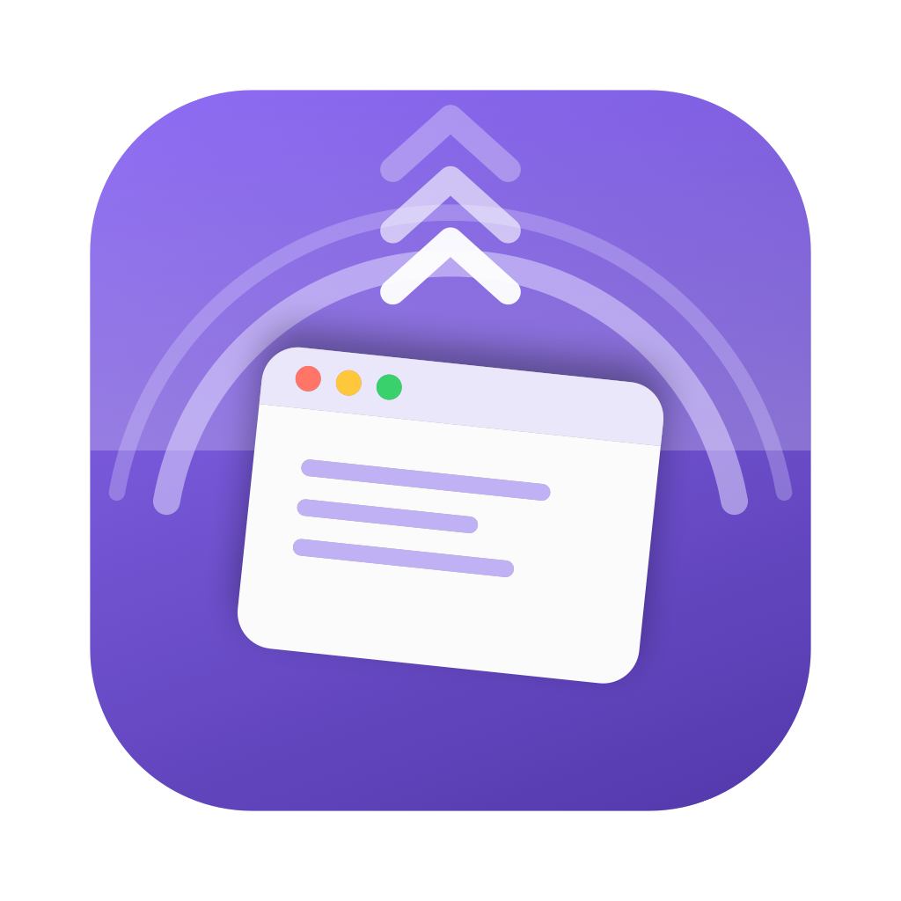
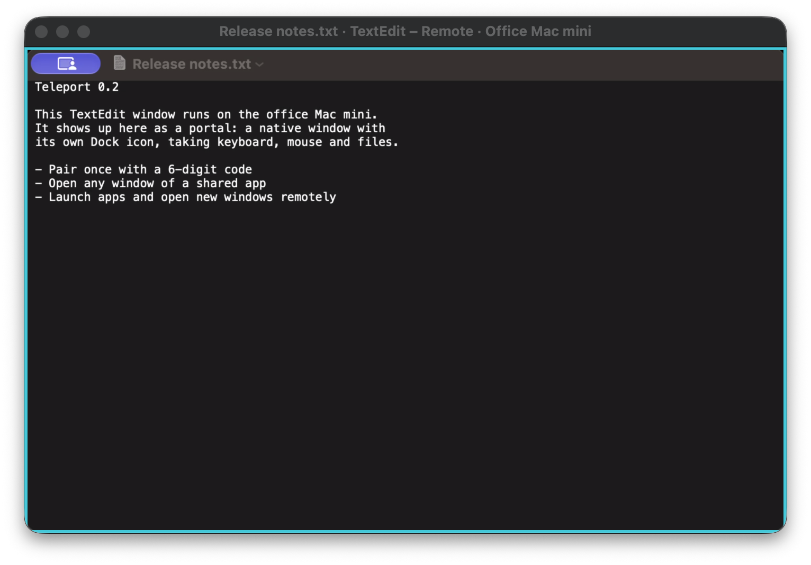
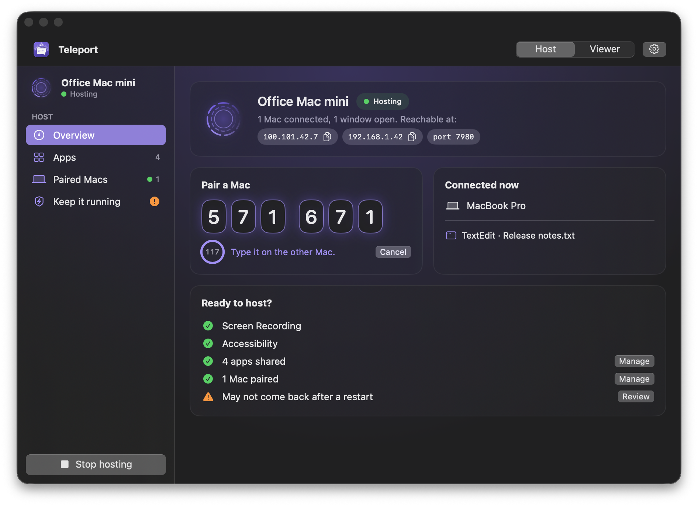
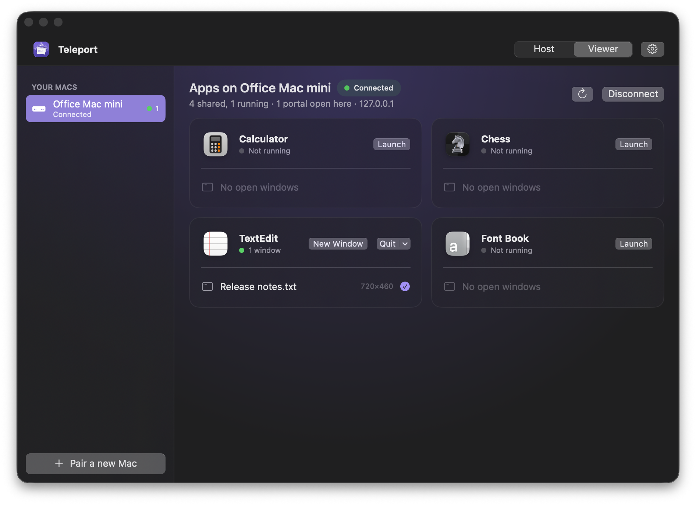
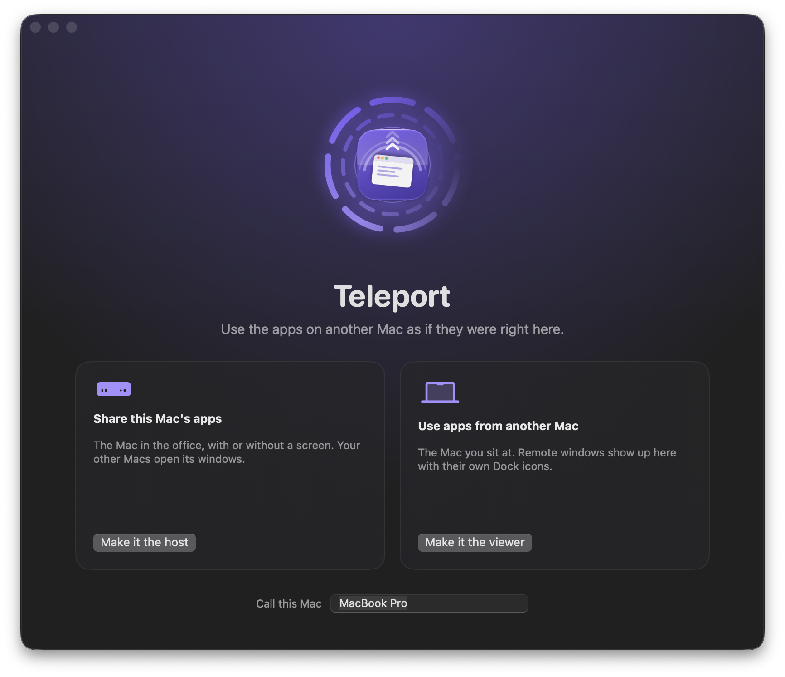
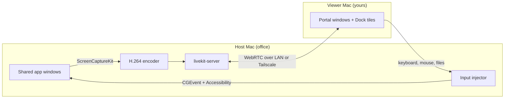

<div align="center">



# Teleport

**Use the apps on another Mac as if they were right here.**

Teleport streams individual app windows from a remote Mac (with or without a screen) to the Mac you work on. Each remote window becomes a native window with its own Dock icon, and takes your keyboard, mouse and dropped files. Think Parallels Coherence, but the apps run on another Mac.

[](https://github.com/estruyf/teleport/releases/latest)
[](https://github.com/estruyf/teleport/actions/workflows/ci.yml)


[](LICENSE)



</div>

## Why

I work on a remote Mac, and most of the time I only need one app from it. Opening a full remote desktop for that means a second desktop in a window, with its own Dock, menu bar and windows I don't need, all to get to that one app.

Teleport fixes that. I open just the app I need, and it shows up as a normal window on the Mac I'm sitting at, next to my own apps, with its own Dock icon. I type, click and drag files into it as if it ran locally, and the rest of the remote Mac stays out of the way.

## Features

- **Window by window.** Open a single window of a remote app, not the whole desktop.
- **Feels local.** Each portal is a native macOS window with its own badged Dock icon. Keyboard, mouse, scroll and resize go straight through.
- **Headless friendly.** The host can create its own virtual Retina display, so a Mac mini without a monitor still renders sharp windows.
- **Pair once, safely.** A one-time 6-digit code and a fingerprint check on both Macs. No accounts, no cloud relay, and the host decides which apps are reachable.
- **Find Macs by name.** Hosts on the same network (Bonjour) or your Tailscale tailnet show up by name.
- **Remote control of apps.** Launch apps, open new windows and quit apps on the host from the viewer's window or menu bar.
- **Clipboard and files.** Text clipboard both ways; drop a file on a portal to send it to the host (experimental).
- **Stays up.** The viewer reconnects after a network blip, the host restarts its streaming server if it dies, and a login item brings the host back after a reboot.
- **Updates itself.** Signed updates through Sparkle. A host installs them on its own while no viewer is connected.

## Screenshots

<table>
  <tr>
    <td width="50%"></td>
    <td width="50%"></td>
  </tr>
  <tr>
    <td align="center"><b>Host</b>: everything that matters on one overview</td>
    <td align="center"><b>Viewer</b>: open, launch or quit apps on the host</td>
  </tr>
  <tr>
    <td colspan="2" align="center"><br><b>First launch</b>: one app, two modes</td>
  </tr>
</table>

## Quick start

Install Teleport on both Macs. They need **macOS 14 or later** on Apple Silicon.

```sh
brew install --cask estruyf/tap/teleport
```

Or download `Teleport-<version>-arm64-mac.zip` from the [latest release](https://github.com/estruyf/teleport/releases/latest). It's signed and notarized, and keeps itself up to date. To build it yourself instead, see [getting started](docs/getting-started.md#build-from-source).

Then:

1. **On the host** (the remote Mac): choose *Share this Mac's apps*, grant **Screen Recording** and **Accessibility**, and add the apps you want to share.
2. **On the viewer** (your Mac): choose *Use apps from another Mac* and press *Pair a new Mac*.
3. **Pair**: press *Show pairing code* on the host, type it on the viewer, check that both Macs show the same fingerprint and press *Allow*.
4. **Open a portal**: connect, then pick a window or launch an app.

The [getting started guide](docs/getting-started.md) covers each step, a headless host, keeping it reachable after a restart, and testing both modes on one Mac.

## How it works



The host runs a [LiveKit](https://livekit.io) server and streams each opened window as its own video track. The viewer shows every track in a native window and sends input back over a data channel. More in [how it works](docs/how-it-works.md).

## Documentation

| Doc | What's in it |
|---|---|
| [Getting started](docs/getting-started.md) | Installing, host and viewer setup, permissions, a headless host, testing on one Mac |
| [How it works](docs/how-it-works.md) | Architecture, the pieces and the source layout |
| [Configuration](docs/configuration.md) | `~/.teleport` files, `config.json`, ports and environment variables |
| [Development](docs/development.md) | npm scripts, tests and CI |
| [Releasing and updates](docs/releasing.md) | Cutting a release, the updater, the Homebrew cask and the signing keys |
| [Security](docs/security.md) | The trust model and its known gaps |
| [Video quality](docs/video-quality.md) | Measuring the video, the `video` settings and the A/B tests to run |
| [Changelog](CHANGELOG.md) | What changed in each release |
| [Roadmap](docs/release-checklist.md) | What's still open, blockers first |

## Status

Teleport is early: 0.1.0 is the first release. Pairing, discovery, streaming, input, resize, clipboard text, Dock tiles, reconnect, the login item, remote launch and quit, notarized releases and in-app updates all work. Not yet verified on a headless Mac. Not there yet: TLS on the signalling socket (Tailscale covers it today; see [security](docs/security.md)), audio, HEVC 4:4:4 and Intel builds. The [roadmap](docs/release-checklist.md) has the full list.

## License

[MIT](LICENSE) © Elio Struyf
