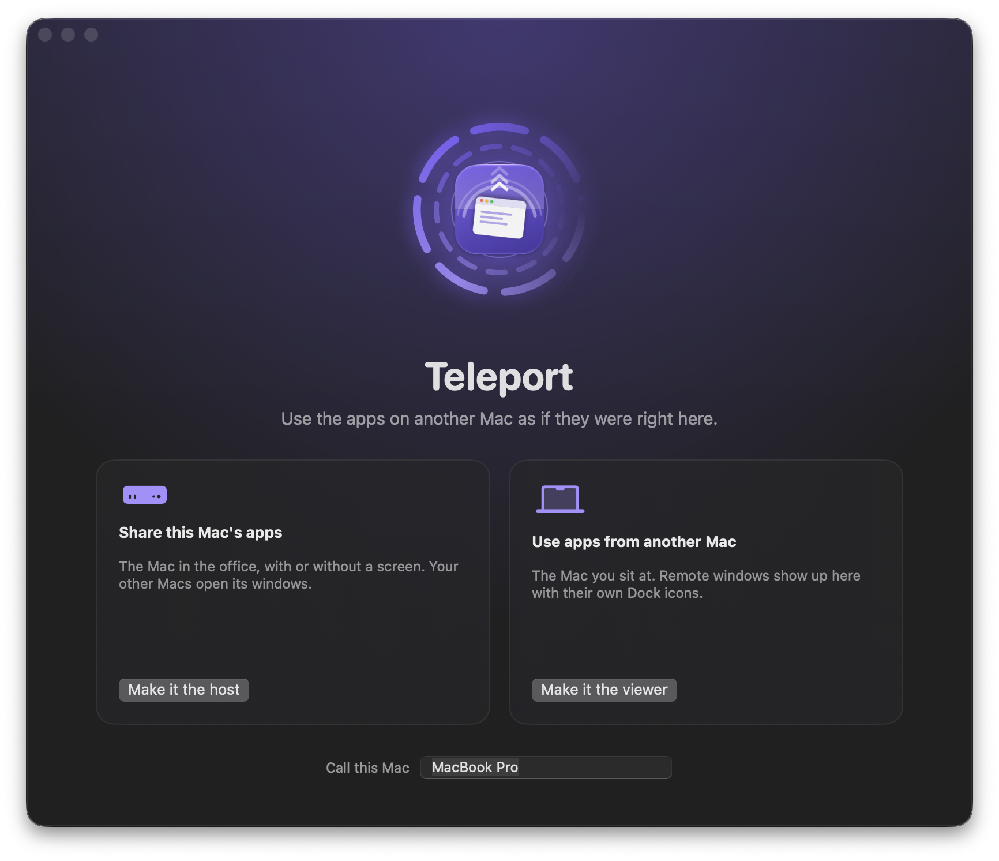
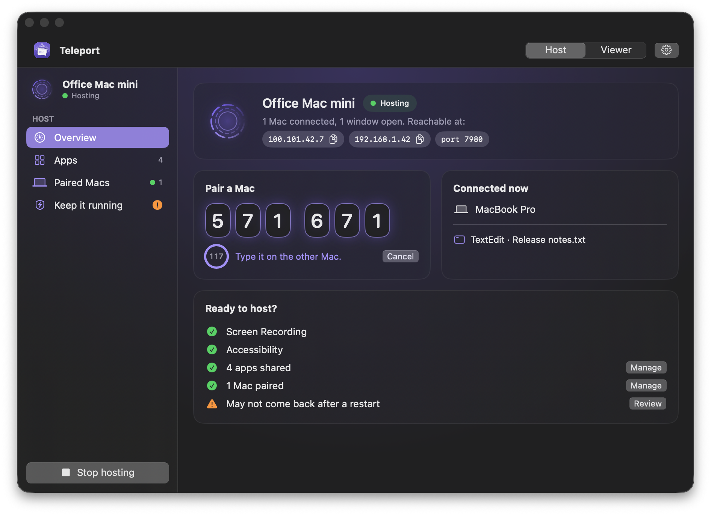
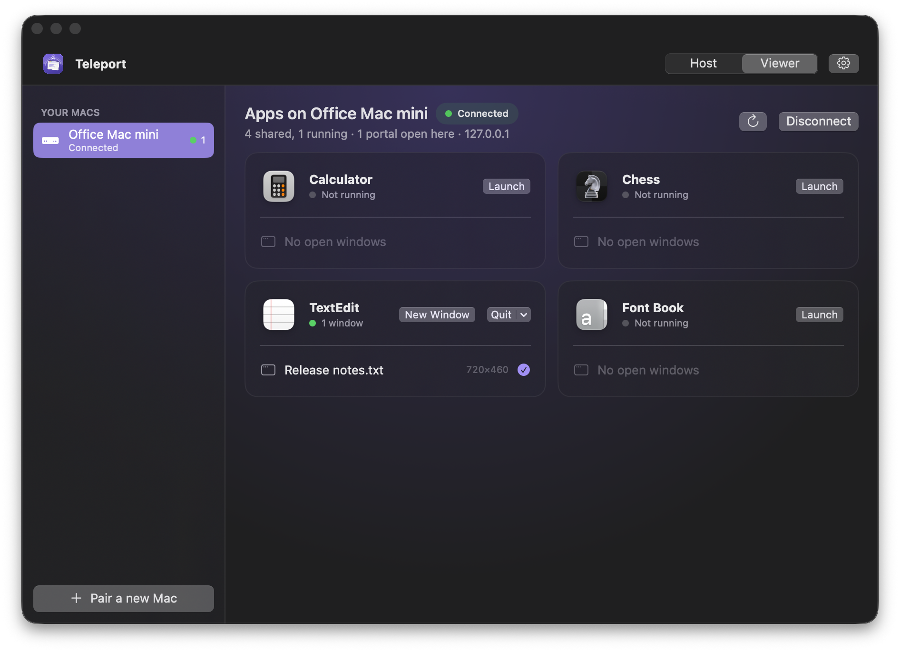

# Getting started

Teleport is one app with two modes. The **host** is the Mac whose apps you want to use (the office Mac, with or without a screen). The **viewer** is the Mac you sit at. The first launch asks which one this Mac is; you can switch later with the *Host / Viewer* toggle at the top of the window.



## Requirements

- Two Macs on **macOS 14 or later**.
- A network path between them: the same LAN, or both on the same [Tailscale](https://tailscale.com) tailnet. Over Tailscale no port forwarding is needed.
- Apple Silicon. Releases are arm64 only for now; an Intel Mac has to [build from source](#build-from-source).

## Install

On both Macs, with [Homebrew](https://brew.sh):

```sh
brew install --cask estruyf/tap/teleport
```

Or download `Teleport-<version>-arm64-mac.zip` from the [latest release](https://github.com/estruyf/teleport/releases/latest), unzip it and move `Teleport.app` to `/Applications`. Releases are signed with a Developer ID and notarized.

Teleport keeps itself up to date. A viewer asks before installing an update. A host installs updates by itself while no viewer is connected, then goes back to hosting. See [releasing and updates](releasing.md#how-updates-work).

### Build from source

You need the Xcode Command Line Tools and Homebrew (for `livekit-server`). Xcode itself is not needed.

```sh
git clone https://github.com/estruyf/teleport.git && cd teleport
npm run deps      # brew install livekit; it is bundled into the app at build time
npm run bundle    # swift build + build/Teleport.app
open build/Teleport.app
```

A debug build doesn't update itself. `npm run dist` makes a signed release zip in `dist/` for another Mac; see [development](development.md).

## Set up the host

1. Open Teleport and choose **Share this Mac's apps**. The host lives in the menu bar; closing the window keeps it running, and the menu bar item reopens it.
2. Grant **Screen Recording** and **Accessibility** when asked. The window shows a notice with a button to System Settings while either is missing.
   - Without Screen Recording nothing can be streamed. After you switch it on, macOS offers *Quit & Reopen*. That's normal.
   - Without Accessibility viewers can see windows but not click or type.
3. In the **Apps** section, press *Add app* and search the installed apps, or drop an `.app` on the sheet. Nothing is shared until you add apps; viewers only see windows of these apps.



The host window has a sidebar with four sections, each of which fits the window:

- **Overview**: whether it's hosting, the addresses viewers can use (the Tailscale address first), the pairing code, who is connected right now, and a *Ready to host?* checklist. Every item that needs attention has its fix button next to it.
- **Apps**: the shared apps, and which of them have a window open in a portal.
- **Paired Macs**: the viewers that may connect, which ones are connected, and *Revoke*.
- **Keep it running**: the settings below.

A sidebar badge shows each section's count, a green dot when a Mac is connected, or an orange mark when something there needs a look.

### Keep the host reachable

The *Keep it running* section has the settings that matter for an office Mac nobody sits at:

- **Start Teleport when this Mac logs in** registers a login item, so a reboot comes back hosting on its own.
- **Keep this Mac from locking itself** is for a Mac that locks after some idle minutes (its own settings or a company policy). While hosting, Teleport counts as someone using it. It can't unlock a Mac that is already locked.
- **After a restart** checks how the Mac signs in. Teleport runs for whoever is signed in, so it needs automatic login to your account, or a sign-in through Screen Sharing. With FileVault on, a restart stops at the disk password before macOS starts; someone has to type it, or restart with `sudo fdesetup authrestart`, which skips it once.
- **Stay unlocked after Screen Sharing.** If you sign in through Screen Sharing, closing it locks the Mac again, and a locked Mac takes no typing. This switch sets macOS's `RestoreMachineState` to keep it unlocked (asks for an admin password). It outlives Teleport, so Teleport offers to switch it back when you quit.

When the host is locked, viewers see a warning: windows still show, but typing and opening new windows won't work until it is unlocked.

### A headless host

With no monitor attached, the host creates a virtual Retina display ("Teleport Stage") so windows have somewhere sharp to render. Its size is in `virtualDisplay` in [`config.json`](configuration.md#configjson). If it misbehaves, an HDMI dummy plug is the fallback.

## Set up the viewer

1. Open Teleport and choose **Use apps from another Mac**.
2. Press **Pair a new Mac**. Hosts on the same network or tailnet are listed by name; otherwise type the address shown on the host.
3. On the host, press **Show pairing code**. Type the 6-digit code on the viewer within two minutes.
4. The host asks whether to allow the viewer. Both Macs show the same fingerprint; if they differ, press *Deny*. After *Allow* the viewer is paired for good, until you revoke it on the host.
5. Your paired Macs are in the sidebar. Select one and press **Open portal** to connect.

Once connected, the viewer lists the host's shared apps with their windows; a check marks the ones already open in a portal here. Click a window to open it as a portal, or use *Launch*, *New window* and *Quit* (Option turns Quit into Force Quit). The same actions are in the menu bar item.



## Using portals

- A portal is a native window with a teal border and a *Remote* badge, titled `<window> – Remote · <host>`. Each remote app gets its own Dock icon, named after the app.
- Keyboard, mouse, scroll and resize go to the host window.
- Copied text syncs both ways (up to 14 KB). Turn it off with `clipboardSync` in [`config.json`](configuration.md#configjson).
- Drop a file on a portal to send it to the host; it lands in `~/Downloads/Teleport/` there. This is experimental.
- If the connection drops, the viewer keeps trying for two minutes and reopens its portals.
- Notifications from the shared apps show up here as Teleport notifications, with the app's icon. See [notifications](#notifications).
- You hear the shared apps, and can talk in their calls. See [sound and microphone](#sound-and-microphone).

## Sound and microphone

While a viewer is connected, the host captures the sound of the shared apps (and only those) and sends it along. You hear Teams ringing, a video playing, or the other side of a call through your own speakers or headset. The host plays nothing itself: its audio engine uses no device, so a Mac without a microphone works, and Teleport makes no sound in the office. The apps' own sound still comes out of the host's speakers if it has any; turn its volume down there.

Turn it off in the host's window under *Sound*, on the viewer under *Settings › Sound*, or with `audio` in [`config.json`](configuration.md#configjson).

### Talking in calls

Your microphone can go to the shared apps too. It is off by default, and it takes a bit of setup, because macOS only lets an app listen to a microphone device. The host's window walks you through it under *Sound › Microphone for calls › How to set it up*, with a button that runs the install in Terminal:

1. **On the host**, install the free virtual audio device BlackHole 2ch: `brew install --cask blackhole-2ch`, which asks for an administrator password. Without Homebrew, use the installer from the [BlackHole project](https://github.com/ExistentialAudio/BlackHole). A company-managed Mac may block the install.
2. **On the host**, check that Teleport found it: the Sound section shows the device, and *Viewer's microphone plays into* picks it on *Automatic*. No restart needed.
3. **On the host**, pick the same device as the microphone in the app, such as *Teams › Settings › Devices › Microphone*. Leave the app's speaker on something else, or the call hears itself.
4. **On the viewer**, turn on *Settings › Sound › Send this Mac's microphone to shared apps*. macOS asks for microphone access right away.

During a call the host's Sound section shows which app is listening, which is a quick way to check step 3.

The viewer then sends its microphone only while a shared app on the host is listening to one: a call is on, say. The host checks this once a second. While it is on, the viewer's window says so and macOS shows its microphone indicator; when the call ends it stops. Echo cancellation runs on the viewer, so you can use speakers instead of a headset.

## Notifications

While a viewer is connected, the host reads the notification banners macOS shows and sends on the ones from shared apps. Notifications from other apps stay on the host. On the viewer they appear as Teleport's, with the app's name under the title and its icon beside it. Clicking one clicks the banner on the host too, so the app opens on what the notification is about (a chat, a mail), and brings that app's portal forward or opens one.

Turn it off on either Mac under *Settings › Between Macs › Notifications from shared apps*, or with `notifications` in [`config.json`](configuration.md#configjson). The viewer asks for permission to show notifications the first time one arrives; after that it is in *System Settings › Notifications › Teleport*.

Some things on the host decide whether there is a banner to send:

- The app's notification style in *System Settings › Notifications* must be *Banners* or *Alerts*, and no Focus may be on.
- The host must be unlocked; see [keep the host reachable](#keep-the-host-reachable).
- macOS hands a notification to the app itself, without a banner, while that app is frontmost on the host. Apps like Teams then decide for themselves whether to show one. Which app is frontmost there follows the portal you last used.
- Banners replace each other, and the host checks a few times a second, so of several that arrive within a fraction of a second only the last may come through.

The host reads banners through Accessibility, which it already needs for input. There is no macOS API for another app's notifications, so a macOS update can change what it reads; the host log says `notifications: forwarded …` for each one it sends.

## Try it on one Mac

You can run a host and a viewer side by side on one Mac. The second instance gets its own identity and settings through `TELEPORT_HOME`:

```sh
npm run start:loopback-host   # a second instance as host, with its own identity in ~/.teleport-host
open -n build/Teleport.app    # the viewer; pair with 127.0.0.1
```

Granting Screen Recording makes macOS offer *Quit & Reopen*. That quits every instance of the app and relaunches one without `TELEPORT_HOME`, so start the loopback host again afterwards.

## Troubleshooting

| Problem | What to do |
|---|---|
| "livekit-server not found" on the host | Rebuild after `npm run deps`, or `brew install livekit` on the host. |
| Viewer: "… no longer knows this Mac" | The host revoked it or lost `trust.json`. Pair again. |
| Viewer: "Can't reach …" | Check that Teleport is hosting on the other Mac and that ports 7880–7883 are reachable (or use Tailscale). |
| Windows show but typing does nothing | The host is locked, or Accessibility is off. See [keep the host reachable](#keep-the-host-reachable). |
| Video looks soft or stutters | See [video quality](video-quality.md). |

Logs are in `~/.teleport/app.log` (`npm run logs`); the [configuration doc](configuration.md#files) lists the others.
