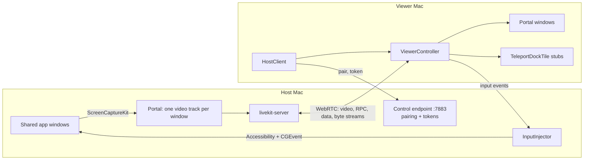

# How it works

Teleport is a SwiftPM project: one macOS app that runs as a host or a viewer, a small Dock-tile stub, and a shared core library. The video and data transport is [LiveKit](https://livekit.io), an open-source WebRTC SFU that runs on the host.



## A session, step by step

1. **Pairing** (once). The viewer posts a pairing request to the host's control endpoint, sealed with a key derived from both device keys and the 6-digit code. The host opens it only if the code matches, shows a fingerprint, and on *Allow* stores the viewer's public key in `trust.json`. See [security](security.md).
2. **Token.** Each time the viewer connects, it asks the control endpoint for a LiveKit token, proving it holds a trusted key. Tokens last one hour; LiveKit refreshes them while connected. The LiveKit secret never leaves the host.
3. **Room.** Both sides join the host's LiveKit room. The viewer calls RPCs to list apps and windows, fetch icons, open or close a window, resize, launch or quit an app.
4. **Portal.** Opening a window starts a ScreenCaptureKit stream of the owning app, cropped to that window, published as its own H.264 video track at native Retina resolution.
5. **Input.** The viewer sends normalised mouse, keyboard and scroll events over a data channel. The host raises the target window through Accessibility and posts `CGEvent`s.

## The pieces

| Piece | Implementation |
|---|---|
| Transport | LiveKit on the host (`livekit-server` bundled into the app); the LiveKit Swift SDK on both sides |
| Video | ScreenCaptureKit captures the owning app cropped to the window, H.264 at native Retina resolution. Tunable for A/B tests; see [video quality](video-quality.md) |
| Control | LiveKit RPC: `apps`, `open`, `close`, `resize`, `launch`, `quit`, `icon` |
| Input | A data channel carries normalised events; the host raises the window via Accessibility and posts `CGEvent`s |
| Files | LiveKit byte streams; dropped files land in `~/Downloads/Teleport/` on the host |
| Pairing | X25519 device keys, HKDF with the one-time code as salt, ChaCha20-Poly1305. The code never travels |
| Headless | A virtual Retina display ("Teleport Stage") via the private `CGVirtualDisplay` API |
| Dock | One `TeleportDockTile` stub process per remote app, named after the app, with a badged icon. It talks to the viewer over `DistributedNotificationCenter` |
| Discovery | Bonjour `_teleport._tcp` on the LAN; Tailscale peers (via the Tailscale CLI) probed for a Teleport host |
| Clipboard | Text, both ways, over the data channel (up to 14 KB) |
| Sound | ScreenCaptureKit captures the shared apps' audio (one stream, filtered to their processes) and feeds LiveKit's mixer (`AudioManager.shared.mixer.capture(appAudio:)`), which sends it as the `app-audio` track: Opus, mono, 48 kHz. The host's audio engine runs in manual rendering mode, so it opens no device. The viewer plays the track with LiveKit's normal playout |
| Microphone | The host polls Core Audio's process list once a second for a shared app (or a helper it is responsible for) running audio input, and says so in `hostStatus` (`microphoneWanted`). The viewer then publishes its microphone as `viewer-mic`, with echo cancellation, and unpublishes it when that ends. The host renders that track into a virtual audio device with its own `AVAudioEngine` |
| Notifications | The host reads banners from Notification Center through Accessibility (subrole `AXNotificationCenterBanner`: an identifier, the app's name in the description, `title`/`subtitle`/`body` texts), a few times a second while a viewer is connected. Those from shared apps go to the viewer on the `notifications` topic, which posts them with `UNUserNotificationCenter`. A click calls `teleport.showNotification`, which presses the banner on the host |
| Lock state | The host watches for screen lock and tells viewers, which show a warning |
| Updates | Sparkle 2, from the EdDSA-signed appcast on the latest GitHub release. A host installs updates only while no viewer is connected; see [releasing and updates](releasing.md) |
| Resilience | The viewer reconnects for two minutes after a drop and reopens its portals; the host restarts `livekit-server` if it dies; a login item brings the host back after a reboot |

## Source layout

```
Sources/
├── TeleportCore/          shared by the app, the Dock tile and the tests
│   ├── Config.swift          ~/.teleport/config.json
│   ├── Identity.swift        device key and pairing crypto
│   ├── PairingProtocol.swift control endpoint messages, trust.json / hosts.json
│   ├── Protocol.swift        RPC and data-channel messages
│   ├── Token.swift           LiveKit access tokens (HS256 JWTs)
│   ├── VideoConfig.swift     the `video` settings
│   └── …                     logging, images, Dock tile IPC, test pattern
├── Teleport/              the app
│   ├── App/                  entry point, mode switching, menu bar, clipboard, login item, stats
│   ├── Host/                 HostController, livekit-server, control server, capture (Portal),
│   │                         input injection, virtual display, discovery, keep-alive
│   ├── Viewer/               ViewerController, HostClient, portal windows, Dock tiles, probe
│   └── UI/                   SwiftUI screens: welcome, host, viewer, shared components
├── TeleportDockTile/      the per-app Dock icon stub
├── TeleportTestPattern/   a window that stamps its frames, for measuring video
└── CPrivate/              declarations for CGVirtualDisplay and _AXUIElementGetWindow
Tests/TeleportCoreTests/   Swift Testing: pairing crypto, config compatibility, video config, test pattern
```

## Private APIs

Two undocumented macOS APIs are used: `CGVirtualDisplay` for the headless display and `_AXUIElementGetWindow` to match Accessibility windows to window IDs. They can break with a macOS update. That's a reliability risk, not a security one.

## Prior art

The video measurement ideas come from [voxl](https://github.com/tembo/voxl); its code is not used.
