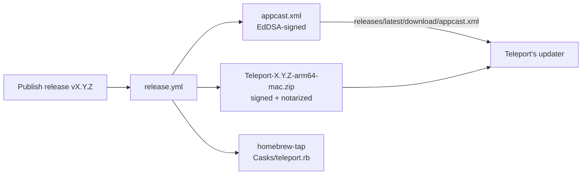

# Releasing and updates

A release is a GitHub release with a `vX.Y.Z` tag. Publishing one starts [`release.yml`](../.github/workflows/release.yml), which builds the app, signs and notarizes it, and attaches the zip and a signed Sparkle appcast to the release. It also updates the cask in [estruyf/homebrew-tap](https://github.com/estruyf/homebrew-tap). Installed copies find the new version through Sparkle.



## How updates work

Teleport uses [Sparkle 2](https://sparkle-project.org). Release bundles carry two keys in `Info.plist`, written by `scripts/bundle.sh`:

- `SUFeedURL`: `https://github.com/estruyf/teleport/releases/latest/download/appcast.xml`. GitHub redirects that to the appcast of the newest published release, skipping prereleases, so the feed needs no hosting of its own.
- `SUPublicEDKey`: the public half of Teleport's EdDSA key. Sparkle refuses an update whose zip isn't signed with the private half, and also checks that the new app has the same Developer ID signature.

Debug builds have no feed, so the updater is off and the *Check for Updates…* items are hidden.

| Mode | Behaviour |
|---|---|
| Viewer | Checks once a day and shows Sparkle's prompt with the release notes. *Check for Updates…* is in the app menu, the menu bar item and Settings. |
| Host | Checks once a day and downloads in the background. A downloaded update installs **only while no viewer is connected**: right away if none is, otherwise as soon as the last one leaves. Teleport then relaunches and goes back to hosting by itself. The menu bar item and Settings show an update that is waiting. |

The automatic checks can be switched off in Settings › Updates. Screen Recording and Accessibility grants survive an update because the Developer ID signature stays the same.

## One-time setup

The workflow needs these repository secrets (*Settings › Secrets and variables › Actions*). The first five have the same names and values as in Tideline and Dock Profiler.

| Secret | What it is |
|---|---|
| `MACOS_CERTIFICATE` | The Developer ID Application certificate and key, exported as `.p12` with an empty password, base64-encoded |
| `APPLE_ID` | The Apple ID used for notarization |
| `APPLE_TEAM_ID` | The team ID (`9YX7DQ75N5`) |
| `APPLE_APP_PASSWORD` | An app-specific password for that Apple ID |
| `HOMEBREW_TAP_TOKEN` | A token with write access to `estruyf/homebrew-tap` (optional; without it the tap step only warns) |
| `SPARKLE_PRIVATE_KEY` | Teleport's Sparkle signing key (below) |

### The Sparkle key

The key pair was made with Sparkle's `generate_keys --account teleport` and lives in the login keychain as *Private key for signing Sparkle updates* (account `teleport`). Its public half is `SPARKLE_PUBLIC_KEY` in `scripts/bundle.sh`. To put the private half in the secret:

```sh
swift package resolve   # fetches Sparkle and its tools into .build/artifacts
KEY="$(mktemp)"
.build/artifacts/sparkle/Sparkle/bin/generate_keys --account teleport -x "$KEY"
gh secret set SPARKLE_PRIVATE_KEY -R estruyf/teleport < "$KEY"
rm -P "$KEY"
```

**Back the key up** (a password manager is fine). If it is lost, every installed copy will reject future updates, and people have to download a new build by hand. Never change `SPARKLE_PUBLIC_KEY` once a release is out.

## Cutting a release

1. Move the `[Unreleased]` entries in [`CHANGELOG.md`](../CHANGELOG.md) under a new `## [0.3.0] - <date>` heading, and add its compare link at the bottom. Write them for people using the app: they become the release notes in Sparkle's prompt.

2. Bump the version on `main`. `package.json` is the only place it lives: the bundle, the appcast and the cask all read it.

   ```sh
   npm version 0.3.0 --no-git-tag-version
   git commit -am "Release 0.3.0" && git push
   ```

3. Publish the release, with that changelog section as its text. The tag must match `package.json`, or the workflow stops.

   ```sh
   awk '/^## \[0.3.0\]/{f=1;next} /^## \[|^\[Unreleased\]:/{f=0} f' CHANGELOG.md > /tmp/notes.md
   gh release create v0.3.0 --title "Teleport 0.3.0" --notes-file /tmp/notes.md
   ```

4. Watch the workflow: `gh run watch -R estruyf/teleport`. When it is green, the release has `Teleport-0.3.0-arm64-mac.zip` and `appcast.xml`, and the tap serves 0.3.0.

A **prerelease** gets the same zip and appcast, but neither the feed (`releases/latest` skips prereleases) nor the tap moves. That makes it a safe way to try a build on the office Mac by hand.

If a run fails after the release is published, fix the problem and re-run the workflow. You can also start it from the *Actions* tab with *Run workflow*, giving the tag; it re-attaches the assets with `--clobber`.

## Installing with Homebrew

```sh
brew install --cask estruyf/tap/teleport
```

The cask has `auto_updates true`, so `brew upgrade` leaves Teleport to Sparkle. `homebrew/teleport.rb` in this repo is the source of the cask. Everything but `version` and `sha256` is edited here, and `homebrew/publish-cask.sh` stamps those two and pushes the cask to the tap. Run it by hand to repair the tap:

```sh
VERSION=0.3.0 ./homebrew/publish-cask.sh          # stamp and print, downloading the zip from the release
VERSION=0.3.0 HOMEBREW_TAP_TOKEN=… ./homebrew/publish-cask.sh --push
```

## Releasing from a Mac

The same steps run locally, with the keys in your keychain:

```sh
NOTARY_PROFILE=teleport npm run dist                 # build, sign, notarize, staple → dist/
scripts/appcast.sh dist/Teleport-0.3.0-arm64-mac.zip \
  https://github.com/estruyf/teleport/releases/download/v0.3.0/Teleport-0.3.0-arm64-mac.zip > dist/appcast.xml
gh release upload v0.3.0 dist/Teleport-0.3.0-arm64-mac.zip dist/appcast.xml
```

`scripts/appcast.sh` signs with the `teleport` key from the keychain when `SPARKLE_PRIVATE_KEY` isn't set.

## Trying an update before it ships

`TELEPORT_FEED_URL` points an app at another appcast and checks it right away (silently, for a host), so an update can be tried without a release:

```sh
# a build of the next version, zipped and signed into a local feed
mkdir -p /tmp/feed && ditto -c -k --sequesterRsrc --keepParent build/Teleport.app /tmp/feed/Teleport-0.3.0.zip
VERSION=0.3.0 scripts/appcast.sh /tmp/feed/Teleport-0.3.0.zip http://127.0.0.1:8765/Teleport-0.3.0.zip > /tmp/feed/appcast.xml
(cd /tmp/feed && python3 -m http.server 8765) &

# an older build, pointed at it
open -n --env TELEPORT_FEED_URL=http://127.0.0.1:8765/appcast.xml /path/to/older/Teleport.app
```

With `TELEPORT_HOME` set as well (a loopback instance), the update installs when that instance quits, and Teleport doesn't relaunch it: a relaunch would lose `TELEPORT_HOME` and start on `~/.teleport`.
